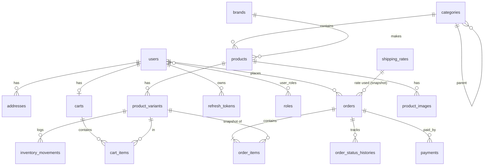

# DATABASE.md — Desain Basis Data SportShop

DBMS: **PostgreSQL 17** (minimal 16). ORM: **EF Core (Npgsql)**. Identity memakai tabel bawaan ASP.NET Core Identity dengan kunci `uuid`.

## 1. Konvensi

| Aspek | Aturan |
|---|---|
| Penamaan | `snake_case` untuk tabel & kolom (`UseSnakeCaseNamingConvention`), tabel jamak (`products`) |
| Primary key | `uuid` (`Guid`), dibuat aplikasi (UUID v7 via `Guid.CreateVersion7()` agar terurut waktu) |
| Waktu | `timestamptz`, selalu UTC. Kolom standar: `created_at`, `updated_at` |
| Uang | `numeric(18,2)`, bernilai bulat rupiah; di C# `decimal` |
| Enum | Disimpan sebagai `text` dengan `CHECK` constraint (mudah dibaca & aman perubahan), dipetakan ke enum C# via `HasConversion<string>()` |
| Soft delete | Kolom `is_active` / `deleted_at` pada produk, varian, kategori, brand (tidak menghapus fisik data yang pernah dipesan) |
| Concurrency | Optimistic: kolom sistem `xmin` sebagai concurrency token (`UseXminAsConcurrencyToken` / `IsRowVersion()`) pada `orders`, `payments`, `product_variants` |
| Foreign key | Default `ON DELETE RESTRICT`; `CASCADE` hanya untuk anak murni (`cart_items`, `product_images`) |
| Migrasi | Folder `Infrastructure/Persistence/Migrations`; satu migrasi per perubahan, nama deskriptif (`AddShippingRates`) |

## 2. Diagram Relasi (ERD)



## 3. Tabel Identity (ASP.NET Core Identity)

Dipakai apa adanya, dengan `ApplicationUser : IdentityUser<Guid>` dan `ApplicationRole : IdentityRole<Guid>`.

| Tabel | Catatan |
|---|---|
| `users` | Ditambah kolom: `full_name varchar(150) NOT NULL`, `is_active bool DEFAULT true`, `created_at`, `updated_at` |
| `roles` | Seed: `Admin`, `Customer` |
| `user_roles`, `user_claims`, `user_logins`, `user_tokens`, `role_claims` | Bawaan Identity |

Index unik: `users.normalized_email` (bawaan Identity `EmailIndex`), `users.normalized_user_name`.

### `refresh_tokens`
| Kolom | Tipe | Keterangan |
|---|---|---|
| id | uuid PK | |
| user_id | uuid FK→users | |
| token_hash | varchar(128) NOT NULL UNIQUE | SHA-256 dari token; token asli tidak disimpan |
| family_id | uuid NOT NULL | Satu rangkaian rotasi; reuse terdeteksi → cabut seluruh family |
| expires_at | timestamptz NOT NULL | |
| created_at | timestamptz NOT NULL | |
| created_by_ip | varchar(45) | |
| revoked_at | timestamptz NULL | |
| replaced_by_token_id | uuid NULL | |
| revoke_reason | varchar(100) NULL | `Logout`, `Rotated`, `ReuseDetected` |

Index: `(user_id)`, `(family_id)`, `(expires_at)` untuk pembersihan.

## 4. Tabel Katalog

### `categories`
| Kolom | Tipe | Keterangan |
|---|---|---|
| id | uuid PK | |
| parent_id | uuid NULL FK→categories | Maks. 2 tingkat (divalidasi aplikasi) |
| name | varchar(100) NOT NULL | |
| slug | varchar(120) NOT NULL | UNIQUE |
| sort_order | int NOT NULL DEFAULT 0 | |
| is_active | bool NOT NULL DEFAULT true | |
| created_at, updated_at | timestamptz | |

### `brands`
| Kolom | Tipe | Keterangan |
|---|---|---|
| id | uuid PK | |
| name | varchar(100) NOT NULL | UNIQUE |
| slug | varchar(120) NOT NULL | UNIQUE |
| logo_url | varchar(500) NULL | |
| is_active | bool NOT NULL DEFAULT true | |
| created_at, updated_at | timestamptz | |

### `products`
| Kolom | Tipe | Keterangan |
|---|---|---|
| id | uuid PK | |
| category_id | uuid NOT NULL FK→categories | |
| brand_id | uuid NOT NULL FK→brands | |
| name | varchar(200) NOT NULL | |
| slug | varchar(220) NOT NULL | UNIQUE |
| description | text NOT NULL DEFAULT '' | |
| base_price | numeric(18,2) NOT NULL | Harga tampil terendah (turunan dari varian; diperbarui aplikasi) untuk sortir/filter cepat |
| is_active | bool NOT NULL DEFAULT true | |
| search_vector | tsvector GENERATED | `to_tsvector('indonesian'/'simple', name || ' ' || description)`, lihat bagian 9 |
| created_at, updated_at | timestamptz | |

Constraint: `CHECK (base_price >= 0)`.
Index: `(category_id)`, `(brand_id)`, `(is_active, base_price)`, GIN `(search_vector)`, trigram GIN pada `name` (ekstensi `pg_trgm`) untuk pencarian toleran salah ketik.

### `product_variants`
| Kolom | Tipe | Keterangan |
|---|---|---|
| id | uuid PK | |
| product_id | uuid NOT NULL FK→products | |
| sku | varchar(64) NOT NULL | UNIQUE |
| option_size | varchar(30) NULL | Mis. `42`, `M`, `L` |
| option_color | varchar(30) NULL | Mis. `Hitam` |
| price | numeric(18,2) NOT NULL | Harga jual varian |
| weight_gram | int NOT NULL | Untuk ongkir |
| stock_quantity | int NOT NULL | Stok tersedia (sudah dikurangi reservasi) |
| is_active | bool NOT NULL DEFAULT true | |
| created_at, updated_at | timestamptz | |
| xmin | xid | Concurrency token |

Constraint: `CHECK (stock_quantity >= 0)`, `CHECK (price >= 0)`, `CHECK (weight_gram > 0)`, UNIQUE `(product_id, option_size, option_color)` (gunakan `NULLS NOT DISTINCT`, PostgreSQL 15+).
Index: `(product_id)`, `(stock_quantity)` parsial `WHERE stock_quantity <= 5` untuk laporan stok menipis.

### `product_images`
| Kolom | Tipe | Keterangan |
|---|---|---|
| id | uuid PK | |
| product_id | uuid NOT NULL FK→products ON DELETE CASCADE | |
| url | varchar(500) NOT NULL | |
| alt_text | varchar(200) NULL | |
| sort_order | int NOT NULL DEFAULT 0 | |
| is_primary | bool NOT NULL DEFAULT false | Maks. satu per produk (unique index parsial `WHERE is_primary`) |

### `inventory_movements`
Jejak audit stok (append-only).

| Kolom | Tipe | Keterangan |
|---|---|---|
| id | uuid PK | |
| variant_id | uuid NOT NULL FK→product_variants | |
| change_quantity | int NOT NULL | Negatif = keluar, positif = masuk |
| reason | text NOT NULL | CHECK: `Initial`, `Sale`, `Cancel`, `Expire`, `ManualAdjust` |
| order_id | uuid NULL FK→orders | Terisi untuk Sale/Cancel/Expire |
| note | varchar(300) NULL | Wajib untuk ManualAdjust |
| created_by | uuid NULL FK→users | |
| created_at | timestamptz NOT NULL | |

Index: `(variant_id, created_at DESC)`, `(order_id)`. Unique parsial `(order_id, variant_id, reason) WHERE reason IN ('Cancel','Expire')` agar pengembalian stok tepat satu kali.

## 5. Tabel Keranjang, Alamat, Ongkir

### `carts`
| Kolom | Tipe | Keterangan |
|---|---|---|
| id | uuid PK | |
| user_id | uuid NOT NULL FK→users | UNIQUE (satu keranjang per pengguna) |
| created_at, updated_at | timestamptz | |

### `cart_items`
| Kolom | Tipe | Keterangan |
|---|---|---|
| id | uuid PK | |
| cart_id | uuid NOT NULL FK→carts ON DELETE CASCADE | |
| variant_id | uuid NOT NULL FK→product_variants | |
| quantity | int NOT NULL | CHECK `quantity > 0` |
| created_at, updated_at | timestamptz | |

UNIQUE `(cart_id, variant_id)`. Harga tidak disimpan; selalu dibaca dari varian saat ditampilkan/checkout.

### `addresses`
| Kolom | Tipe | Keterangan |
|---|---|---|
| id | uuid PK | |
| user_id | uuid NOT NULL FK→users | |
| label | varchar(50) NOT NULL | Rumah, Kantor |
| recipient_name | varchar(150) NOT NULL | |
| phone | varchar(20) NOT NULL | |
| province_code | varchar(10) NOT NULL FK→shipping_rates.province_code | |
| city | varchar(100) NOT NULL | |
| district | varchar(100) NULL | |
| postal_code | varchar(10) NOT NULL | |
| street | varchar(300) NOT NULL | |
| is_default | bool NOT NULL DEFAULT false | Unique index parsial `(user_id) WHERE is_default` |
| is_deleted | bool NOT NULL DEFAULT false | Soft delete (alamat bisa direferensikan pesanan lama via snapshot) |
| created_at, updated_at | timestamptz | |

### `shipping_rates`
| Kolom | Tipe | Keterangan |
|---|---|---|
| province_code | varchar(10) PK | Kode provinsi (seed) |
| province_name | varchar(100) NOT NULL | |
| base_fee | numeric(18,2) NOT NULL | Biaya dasar |
| per_kg_fee | numeric(18,2) NOT NULL | Biaya per kg |
| estimated_days_min | smallint NOT NULL | |
| estimated_days_max | smallint NOT NULL | |
| is_active | bool NOT NULL DEFAULT true | |
| updated_at | timestamptz | |

## 6. Tabel Pesanan & Pembayaran

### `orders`
| Kolom | Tipe | Keterangan |
|---|---|---|
| id | uuid PK | |
| order_number | varchar(30) NOT NULL UNIQUE | `SPT-YYYYMMDD-XXXXXX` (juga dipakai sebagai `order_id` Midtrans) |
| user_id | uuid NOT NULL FK→users | |
| status | text NOT NULL | CHECK: `PendingPayment`, `Paid`, `Processing`, `Shipped`, `Completed`, `Cancelled`, `Expired` |
| subtotal | numeric(18,2) NOT NULL | |
| shipping_fee | numeric(18,2) NOT NULL | |
| total | numeric(18,2) NOT NULL | `= subtotal + shipping_fee` (CHECK) |
| ship_recipient_name | varchar(150) NOT NULL | Snapshot alamat |
| ship_phone | varchar(20) NOT NULL | |
| ship_province_code | varchar(10) NOT NULL | |
| ship_province_name | varchar(100) NOT NULL | |
| ship_city | varchar(100) NOT NULL | |
| ship_postal_code | varchar(10) NOT NULL | |
| ship_street | varchar(300) NOT NULL | |
| total_weight_gram | int NOT NULL | |
| courier | varchar(50) NULL | Diisi admin saat Shipped |
| tracking_number | varchar(80) NULL | Diisi admin saat Shipped |
| expires_at | timestamptz NOT NULL | `created_at + 24 jam` |
| paid_at, shipped_at, completed_at, cancelled_at | timestamptz NULL | |
| cancel_reason | varchar(300) NULL | |
| idempotency_key | varchar(100) NULL | UNIQUE `(user_id, idempotency_key)` parsial `WHERE idempotency_key IS NOT NULL` |
| created_at, updated_at | timestamptz | |
| xmin | xid | Concurrency token |

Index: `(user_id, created_at DESC)`, `(status, created_at DESC)`, parsial `(expires_at) WHERE status = 'PendingPayment'` untuk job kedaluwarsa.

### `order_items`
| Kolom | Tipe | Keterangan |
|---|---|---|
| id | uuid PK | |
| order_id | uuid NOT NULL FK→orders | |
| variant_id | uuid NOT NULL FK→product_variants | Referensi, bukan sumber nilai |
| product_name | varchar(200) NOT NULL | Snapshot |
| variant_label | varchar(100) NOT NULL | Snapshot, mis. `Ukuran 42 / Hitam` |
| sku | varchar(64) NOT NULL | Snapshot |
| image_url | varchar(500) NULL | Snapshot |
| unit_price | numeric(18,2) NOT NULL | Snapshot |
| quantity | int NOT NULL | CHECK `> 0` |
| line_total | numeric(18,2) NOT NULL | `= unit_price * quantity` |

Index: `(order_id)`, `(variant_id)` (laporan produk terlaris).

### `order_status_histories`
| Kolom | Tipe | Keterangan |
|---|---|---|
| id | uuid PK | |
| order_id | uuid NOT NULL FK→orders | |
| from_status | text NULL | |
| to_status | text NOT NULL | |
| note | varchar(300) NULL | |
| changed_by | uuid NULL FK→users | NULL = sistem (webhook/job) |
| created_at | timestamptz NOT NULL | |

Index: `(order_id, created_at)`.

### `payments`
| Kolom | Tipe | Keterangan |
|---|---|---|
| id | uuid PK | |
| order_id | uuid NOT NULL FK→orders | |
| provider | varchar(30) NOT NULL DEFAULT 'Midtrans' | |
| status | text NOT NULL | CHECK: `Pending`, `Settlement`, `Capture`, `Deny`, `Cancel`, `Expire`, `Failure`, `Refund` |
| gross_amount | numeric(18,2) NOT NULL | |
| snap_token | varchar(200) NULL | |
| snap_redirect_url | varchar(500) NULL | |
| payment_type | varchar(50) NULL | `qris`, `bank_transfer`, `gopay`, dll. |
| transaction_id | varchar(100) NULL | Dari Midtrans |
| fraud_status | varchar(20) NULL | |
| transaction_time | timestamptz NULL | |
| settled_at | timestamptz NULL | |
| last_notification_at | timestamptz NULL | |
| raw_last_payload | jsonb NULL | Payload notifikasi terakhir (tanpa data sensitif), untuk audit |
| created_at, updated_at | timestamptz | |
| xmin | xid | Concurrency token |

Constraint: UNIQUE parsial `(order_id) WHERE status IN ('Pending','Settlement','Capture')` agar hanya ada satu pembayaran aktif/sukses per pesanan.
Index: `(order_id)`, `(transaction_id)`, `(status, created_at)` (rekonsiliasi).

### `payment_notifications` (log idempotensi webhook)
| Kolom | Tipe | Keterangan |
|---|---|---|
| id | uuid PK | |
| payment_id | uuid NULL FK→payments | |
| order_number | varchar(30) NOT NULL | |
| transaction_id | varchar(100) NULL | |
| transaction_status | varchar(30) NOT NULL | |
| status_code | varchar(5) NOT NULL | |
| signature_valid | bool NOT NULL | |
| payload | jsonb NOT NULL | |
| received_at | timestamptz NOT NULL | |
| dedup_key | varchar(200) NOT NULL UNIQUE | `order_number|transaction_status|status_code|transaction_time` |

## 7. Tabel Pendukung

| Tabel | Tujuan |
|---|---|
| `hangfire.*` | Skema `hangfire` dibuat otomatis oleh `Hangfire.PostgreSql` (jangan dimigrasi EF) |
| `email_outbox` (opsional P1) | `id, to_email, subject, body_html, status, attempts, created_at, sent_at` — pola outbox agar email tidak hilang jika SMTP down |

## 8. Aturan Integritas yang Ditegakkan Database

| Aturan | Mekanisme |
|---|---|
| Stok tidak negatif | `CHECK (stock_quantity >= 0)` + update atomik |
| Total pesanan benar | `CHECK (total = subtotal + shipping_fee)` |
| Satu alamat utama per user | Unique index parsial |
| Satu gambar utama per produk | Unique index parsial |
| Satu pembayaran aktif per pesanan | Unique index parsial |
| Pengembalian stok sekali | Unique index parsial di `inventory_movements` |
| Status valid | `CHECK` pada kolom status |
| Checkout tidak ganda | UNIQUE `(user_id, idempotency_key)` |

### Pola pengurangan stok (di dalam transaksi checkout)

```sql
UPDATE product_variants
SET stock_quantity = stock_quantity - @qty, updated_at = now()
WHERE id = @variantId AND is_active AND stock_quantity >= @qty;
-- rows affected = 0  → stok tidak cukup → rollback seluruh transaksi
```

Urutan: buka transaksi (`ReadCommitted`) → urutkan varian berdasarkan `id` (mencegah deadlock) → kurangi stok tiap varian → buat `orders` + `order_items` + `inventory_movements` + `order_status_histories` → kosongkan keranjang → commit. Pembuatan transaksi Snap dilakukan **setelah commit** (panggilan eksternal tidak boleh berada di dalam transaksi DB).

## 9. Pencarian

- Ekstensi: `pg_trgm`, `unaccent`.
- Kolom `search_vector` (generated, `STORED`) memakai konfigurasi `simple` (PostgreSQL tidak membawa stemmer Indonesia bawaan) dengan `unaccent`.
- Query: `search_vector @@ websearch_to_tsquery('simple', @q)` diurutkan `ts_rank`; fallback `name % @q` (trigram) bila hasil kosong.
- Alternatif jika EF sulit memetakan: sediakan method raw SQL di `ProductReadRepository`.

## 10. Redis (Cache & Utilitas)

| Key | Isi | TTL | Invalidasi |
|---|---|---|---|
| `cat:tree:v1` | Pohon kategori | 1 jam | Saat CRUD kategori |
| `brand:list:v1` | Daftar brand | 1 jam | Saat CRUD brand |
| `prod:detail:{slug}:v1` | DTO detail produk | 5 menit | Saat produk/varian/stok berubah |
| `prod:list:{hash-query}:v1` | Hasil daftar (halaman 1–3) | 2 menit | TTL saja |
| `ship:rates:v1` | Tarif ongkir | 1 jam | Saat tarif diubah |
| `rl:{ip}:{endpoint}` | Penghitung rate limit (jika dipindah ke Redis) | 1 menit | TTL |
| `idem:{userId}:{key}` | Cadangan cek idempotensi cepat | 24 jam | TTL |

Aturan: **stok yang ditampilkan di keranjang/checkout tidak boleh dari cache**; selalu dari database. Pola cache-aside lewat `ICacheService`; kegagalan Redis tidak boleh menggagalkan request (fallback ke database, log warning).

## 11. Seed Data

| Data | Sumber |
|---|---|
| Roles `Admin`, `Customer` | Seeder saat startup (idempoten) |
| Admin awal | Email/password dari environment (`SEED_ADMIN_EMAIL`, `SEED_ADMIN_PASSWORD`), hanya jika belum ada admin |
| `shipping_rates` | Seluruh provinsi Indonesia dengan tarif contoh |
| Katalog demo (dev saja) | ±30 produk, 3 kategori induk, 8 brand, 2–5 varian per produk; flag `SEED_DEMO_DATA=true` |

## 12. Retensi & Pemeliharaan

- Job Hangfire harian: hapus `refresh_tokens` kedaluwarsa > 30 hari; hapus `payment_notifications` > 180 hari.
- Data pesanan, pembayaran, dan pergerakan stok **tidak dihapus** (kebutuhan audit).
- Backup: `pg_dump` terjadwal di luar aplikasi (dokumentasikan di README deploy).
