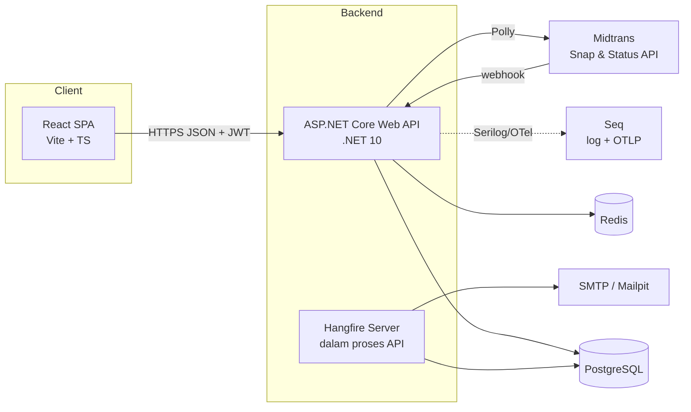

# DESIGN.md — Desain Teknis & Antarmuka SportShop

Dokumen ini mencakup (A) desain arsitektur backend, (B) kontrak API, (C) infrastruktur & DevOps, dan (D) desain frontend/UI.

---

# A. Arsitektur Backend

## A1. Gambaran Sistem



Hangfire berjalan di proses API pada MVP (satu container). Bila beban naik, pisahkan menjadi proyek worker tanpa mengubah kode job (job ada di Infrastructure).

## A2. Layer & Isi Proyek

```
SportShop.Domain
  Common/        Entity, AggregateRoot, ValueObject, DomainException
  Catalog/       Product, ProductVariant, Category, Brand, ProductImage
  Carts/         Cart, CartItem
  Orders/        Order (aggregate), OrderItem, OrderStatus, OrderStatusHistory
  Payments/      Payment, PaymentStatus
  Shipping/      ShippingRate, ShippingCalculator (aturan hitung ongkir)
  Inventory/     InventoryMovement, StockReason
  Users/         Address

SportShop.Application
  Abstractions/  IAppDbContext (tipis) atau repository, IClock, ICacheService, IPaymentGateway,
                 IEmailSender, ICurrentUser, IFileStorage, IJwtTokenService
  Common/        Result<T>, Error, PagedResult<T>, behavior (validasi, logging)
  Features/
    Auth/        Register, Login, Refresh, Logout, ForgotPassword, ResetPassword, ChangePassword
    Catalog/     ListProducts, GetProductBySlug, ListCategories, ListBrands, + command admin
    Cart/        GetCart, AddItem, UpdateItem, RemoveItem, Clear
    Addresses/   CRUD
    Shipping/    GetQuote, + admin CRUD tarif
    Orders/      Checkout, ListMyOrders, GetOrder, CancelOrder, + admin (List, Process, Ship, Complete, Cancel)
    Payments/    CreateSnapTransaction, HandleMidtransNotification, ReconcilePending
    Admin/       DashboardSummary, AdjustStock
  Mapping/       Mapperly mapper (ProductMapper, OrderMapper, ...)

SportShop.Infrastructure
  Persistence/   AppDbContext, Configurations/, Migrations/, Repositories, Seed/
  Identity/      ApplicationUser, ApplicationRole, JwtTokenService, RefreshTokenStore
  Payments/      MidtransClient (HttpClient + Polly), MidtransOptions, signature verifier
  Caching/       RedisCacheService
  Jobs/          ExpireUnpaidOrdersJob, ReconcilePaymentsJob, SendEmailJob, CleanupJob
  Email/         SmtpEmailSender
  Storage/       LocalFileStorage
  Observability/ Serilog & OpenTelemetry setup, HealthChecks

SportShop.Api
  Controllers/   Tipis; satu controller per sumber daya
  Middleware/    ExceptionHandling (ProblemDetails), CorrelationId, SecurityHeaders
  Extensions/    DI per modul, Swagger, Auth, RateLimiting
  Program.cs
```

Catatan: handler Application mengakses data lewat interface (`IProductRepository`, `IOrderRepository`, `IUnitOfWork`, dsb.) atau `IAppDbContext` yang hanya mengekspos `DbSet` — pilih **satu** pola dan konsisten. Rekomendasi proyek ini: repository untuk aggregate tulis (Order, Cart, Payment), dan *read service* khusus dengan proyeksi untuk query baca (katalog, daftar pesanan).

## A3. Pola & Keputusan Desain

| Topik | Keputusan | Alasan |
|---|---|---|
| Use case | Handler per fitur, tanpa MediatR | Sederhana, eksplisit, tanpa dependensi tambahan |
| Hasil operasi | `Result<T>` + `Error(code, message, type)` | Hindari exception untuk alur normal |
| Validasi | FluentValidation, dijalankan di filter/pipeline sebelum handler | Satu tempat validasi |
| Mapping | Mapperly (source generator) | Cepat, tanpa refleksi, aman saat compile |
| Domain | Aggregate `Order` memegang transisi status; method `MarkPaid()`, `Ship(courier, awb)`, `Cancel(reason)` melempar `DomainException` untuk transisi ilegal | Aturan terpusat dan mudah diuji |
| Transaksi | `IUnitOfWork.ExecuteInTransactionAsync` untuk checkout, batal, expire | Konsistensi stok & pesanan |
| Konkurensi | Update stok atomik + `xmin` pada order/payment; retry sekali pada `DbUpdateConcurrencyException` di webhook | Aman terhadap race |
| Idempotensi | `Idempotency-Key` (checkout), `dedup_key` (webhook) | Aman terhadap klik ganda & duplikat |
| Waktu | `TimeProvider` | Mudah diuji |
| Konfigurasi | `IOptions<T>` + `ValidateOnStart` | Gagal cepat saat salah konfigurasi |

## A4. Alur Checkout & Pembayaran

```mermaid
sequenceDiagram
    participant C as Customer (SPA)
    participant A as API
    participant D as PostgreSQL
    participant M as Midtrans

    C->>A: POST /api/v1/orders/checkout {addressId} + Idempotency-Key
    A->>D: BEGIN; baca cart, varian, tarif
    A->>D: UPDATE stok atomik per varian
    A->>D: INSERT order, items, history, movements; kosongkan cart
    A->>D: COMMIT
    A->>M: POST /snap/v1/transactions (Polly)
    M-->>A: token + redirect_url
    A->>D: INSERT payment (Pending, snap_token)
    A-->>C: 201 {orderNumber, snapToken, redirectUrl}
    C->>M: Snap popup, pelanggan membayar
    M-->>A: POST /payments/midtrans/notification
    A->>A: verifikasi signature (SHA512)
    A->>M: GET /v2/{order_id}/status (konfirmasi)
    A->>D: update payment + order → Paid (idempoten)
    A-->>M: 200 OK
    C->>A: GET /orders/{number} (polling status)
    A-->>C: status = Paid
```

Bila pembuatan token Snap gagal setelah commit: pesanan tetap `PendingPayment`, respons berisi `paymentStatus: "token_unavailable"`; customer bisa menekan "Bayar" lagi (`POST /orders/{n}/pay`) tanpa membuat pesanan baru.

## A5. Pemetaan Status Midtrans → Sistem

| `transaction_status` | `fraud_status` | Payment | Order |
|---|---|---|---|
| `capture` | `accept` | Capture | → Paid |
| `capture` | `challenge` | Pending | tetap PendingPayment (tunggu keputusan) |
| `settlement` | — | Settlement | → Paid |
| `pending` | — | Pending | tetap |
| `deny`, `failure` | — | Deny/Failure | tetap PendingPayment (customer boleh coba lagi sampai kedaluwarsa) |
| `cancel` | — | Cancel | → Cancelled (stok kembali) |
| `expire` | — | Expire | → Expired (stok kembali) |
| `refund`, `partial_refund` | — | Refund | Dicatat; tidak mengubah status otomatis (ditangani admin) |

Aturan: status pembayaran final (`Settlement`, `Cancel`, `Expire`) tidak dapat diubah mundur oleh notifikasi lama.

## A6. Background Jobs (Hangfire)

| Job | Jadwal | Fungsi |
|---|---|---|
| `ExpireUnpaidOrdersJob` | Tiap 5 menit | Cari `PendingPayment` dengan `expires_at < now`, ubah ke `Expired`, kembalikan stok (batch 100, per-pesanan satu transaksi) |
| `ReconcilePaymentsJob` | Tiap 10 menit | Untuk `payments.Pending` > 15 menit, panggil Midtrans Status API, terapkan hasil |
| `SendEmailJob` | Fire-and-forget (retry 5x) | Kirim email transaksional |
| `CleanupJob` | Harian 02:00 | Bersihkan token & log lama |

Semua job idempoten dan memakai `[AutomaticRetry]` dengan batas. Dashboard `/hangfire` hanya untuk role Admin.

## A7. Resiliensi (Polly)

`HttpClient` Midtrans dikonfigurasi dengan `AddStandardResilienceHandler` / pipeline kustom:
- Timeout per percobaan: 10 detik; total: 30 detik.
- Retry: 3x, backoff eksponensial dengan jitter, hanya untuk kegagalan transient (5xx, 408, timeout).
- Circuit breaker: buka setelah 50% gagal dari minimal 10 permintaan dalam 30 detik; jeda 30 detik.
- **Tidak** me-retry operasi non-idempoten tanpa kunci: pembuatan transaksi memakai `order_id` unik sehingga aman diulang (Midtrans menolak duplikat; handler menangani `406/duplicate` dengan mengambil status).

## A8. Observabilitas

| Aspek | Implementasi |
|---|---|
| Log | Serilog: console (JSON di Docker) + sink Seq. Enrich: `TraceId`, `SpanId`, `UserId` (bila ada), `MachineName`. Level Production: Information; `Microsoft.*` Warning |
| Trace | OpenTelemetry: ASP.NET Core, HttpClient, EF Core (Npgsql), Redis; export OTLP ke Seq (`/ingest/otlp`) |
| Metrik | OpenTelemetry Metrics: runtime, ASP.NET Core; metrik kustom `orders_created_total`, `payments_settled_total`, `stock_conflicts_total` |
| Health | `/health/live` (proses hidup), `/health/ready` (PostgreSQL, Redis, Hangfire storage); detail hanya untuk Admin |
| Korelasi | Header `X-Correlation-Id` (dibuat bila tidak ada), `traceId` dimasukkan ke ProblemDetails |

## A9. Keamanan Autentikasi

- Identity menyimpan pengguna; `JwtTokenService` menerbitkan token (HS256 atau RS256; MVP: HS256 dengan key ≥ 32 byte dari secret). Klaim: `sub`, `email`, `role`, `jti`, `name`.
- `ClockSkew` = 30 detik. Validasi issuer, audience, lifetime, signing key.
- **Penyimpanan token di frontend**: access token di memori (Zustand, tidak persist); refresh token di cookie `HttpOnly; Secure; SameSite=Strict` (path `/api/v1/auth`). Dengan begitu, XSS tidak dapat mencuri refresh token. Di dev (beda origin) dipakai CORS `AllowCredentials` dengan origin eksplisit.
- Endpoint auth dibatasi rate limit (mis. 10/menit/IP). Respons login tidak membedakan "email tidak ada" vs "password salah".
- Kebijakan otorisasi: `RequireRole("Admin")` untuk `/api/v1/admin/*`; pengecekan kepemilikan di handler (`ICurrentUser.Id`).

---

# B. Kontrak API (v1)

Base path: `/api/v1`. Format JSON `camelCase`. Waktu ISO-8601 UTC. Paginasi: `?page=1&pageSize=20` (maks 100), respons `{ items, page, pageSize, totalItems, totalPages }`.

## B1. Format Error (RFC 7807)

```json
{
  "type": "https://sportshop.dev/errors/stock.insufficient",
  "title": "Stok tidak mencukupi",
  "status": 409,
  "detail": "Stok varian SKU-123 hanya tersisa 2.",
  "code": "stock.insufficient",
  "traceId": "00-4bf92f3577b34da6a3ce929d0e0e4736-00f067aa0ba902b7-01",
  "errors": { "quantity": ["Jumlah melebihi stok"] }
}
```

| HTTP | Digunakan untuk |
|---|---|
| 400 | Validasi gagal (`errors` berisi per field) |
| 401 | Tidak login / token tidak valid |
| 403 | Peran tidak cukup |
| 404 | Tidak ditemukan (termasuk sumber daya milik orang lain) |
| 409 | Konflik: stok, transisi status, duplikat |
| 422 | Aturan bisnis dilanggar (mis. tarif ongkir tidak ada) |
| 429 | Rate limit |
| 500 | Kesalahan tak terduga (detail disembunyikan) |

## B2. Endpoint

**Auth** (`/auth`)
| Method | Path | Akses | Keterangan |
|---|---|---|---|
| POST | `/auth/register` | Publik | Daftar customer |
| POST | `/auth/login` | Publik | Mengembalikan `accessToken`, `expiresIn`; set cookie refresh |
| POST | `/auth/refresh` | Cookie | Rotasi refresh token |
| POST | `/auth/logout` | Login | Cabut refresh token |
| POST | `/auth/forgot-password` | Publik | Kirim email reset |
| POST | `/auth/reset-password` | Publik | Reset dengan token |
| GET/PUT | `/me` | Login | Profil |
| POST | `/me/change-password` | Login | |

**Katalog** (publik)
| Method | Path | Keterangan |
|---|---|---|
| GET | `/products` | Query: `q, categorySlug, brandSlug, minPrice, maxPrice, inStock, sort(newest\|price_asc\|price_desc\|name), page, pageSize` |
| GET | `/products/{slug}` | Detail + varian + gambar |
| GET | `/categories` | Pohon kategori |
| GET | `/brands` | Daftar brand |

**Keranjang** (Customer)
| Method | Path |
|---|---|
| GET | `/cart` |
| POST | `/cart/items` `{variantId, quantity}` |
| PUT | `/cart/items/{variantId}` `{quantity}` |
| DELETE | `/cart/items/{variantId}` |
| DELETE | `/cart` |

**Alamat & ongkir** (Customer)
| Method | Path |
|---|---|
| GET/POST | `/addresses` |
| PUT/DELETE | `/addresses/{id}` |
| POST | `/addresses/{id}/set-default` |
| GET | `/shipping/provinces` |
| POST | `/shipping/quote` `{addressId}` → ongkir untuk isi keranjang |

**Pesanan & pembayaran** (Customer)
| Method | Path | Keterangan |
|---|---|---|
| POST | `/orders/checkout` | Header `Idempotency-Key`; body `{addressId}` |
| GET | `/orders` | Daftar milik sendiri, filter `status` |
| GET | `/orders/{orderNumber}` | Detail + riwayat status + info pembayaran |
| POST | `/orders/{orderNumber}/cancel` | Hanya `PendingPayment` |
| POST | `/orders/{orderNumber}/pay` | Buat ulang/ambil token Snap |
| POST | `/payments/midtrans/notification` | **Publik** (webhook), diverifikasi signature |

**Admin** (`/admin`, role Admin)
| Method | Path |
|---|---|
| GET/POST | `/admin/products` ; GET/PUT/DELETE `/admin/products/{id}` |
| POST/PUT/DELETE | `/admin/products/{id}/variants` , `/admin/variants/{id}` |
| POST/DELETE | `/admin/products/{id}/images` |
| CRUD | `/admin/categories` , `/admin/brands` |
| POST | `/admin/variants/{id}/stock-adjustments` `{changeQuantity, note}` |
| GET | `/admin/inventory/low-stock` |
| GET | `/admin/orders` (filter `status, from, to, q`) ; GET `/admin/orders/{orderNumber}` |
| POST | `/admin/orders/{n}/process` , `/ship {courier, trackingNumber}` , `/complete` , `/cancel {reason}` |
| GET/PUT | `/admin/shipping-rates` , `/admin/shipping-rates/{provinceCode}` |
| GET | `/admin/dashboard/summary` |

Semua endpoint didokumentasikan di Swagger dengan skema Bearer; contoh request/response disertakan untuk checkout dan webhook.

---

# C. Infrastruktur & DevOps

## C1. docker-compose (dev)

| Service | Image | Port | Catatan |
|---|---|---|---|
| `api` | build `backend/` | 5080 | Healthcheck `/health/live`; depends_on db, redis (healthy) |
| `web` | build `frontend/` (dev: Vite; prod: Nginx) | 5173 / 80 | |
| `db` | `postgres:17` | 5432 | Volume `pgdata`; healthcheck `pg_isready` |
| `redis` | `redis:7-alpine` | 6379 | Volume opsional |
| `seq` | `datalust/seq` | 5341 (UI), 5342 (ingest) | `ACCEPT_EULA=Y`; volume `seqdata` |
| `mailpit` | `axllent/mailpit` | 8025 (UI), 1025 (SMTP) | Khusus dev |

Backend memakai Dockerfile multi-stage (`sdk` → `aspnet`, user non-root, `ASPNETCORE_URLS=http://+:8080`). Rahasia lewat `.env` (tidak di-commit) + `.env.example` yang di-commit.

## C2. Konfigurasi Penting (env)

`ConnectionStrings__Default`, `Redis__ConnectionString`, `Jwt__Key`, `Jwt__Issuer`, `Jwt__Audience`, `Midtrans__ServerKey`, `Midtrans__ClientKey`, `Midtrans__IsProduction`, `Cors__Origins`, `Seq__ServerUrl`, `Otel__OtlpEndpoint`, `Smtp__Host/Port/User/Password/From`, `SEED_ADMIN_EMAIL`, `SEED_ADMIN_PASSWORD`, `Order__ExpiryHours` (default 24).

## C3. GitHub Actions

| Workflow | Pemicu | Langkah |
|---|---|---|
| `ci-backend.yml` | PR & push ke `main` (path `backend/**`) | setup-dotnet 10 → restore (cache NuGet) → build `-warnaserror` → `dotnet format --verify-no-changes` → test (Testcontainers; runner `ubuntu-latest` sudah ada Docker) + coverage → unggah artefak laporan |
| `ci-frontend.yml` | PR & push (path `frontend/**`) | setup-node (cache npm) → `npm ci` → lint → typecheck → test → build |
| `docker.yml` | Push tag `v*` / `main` | Build & push image API dan web ke GHCR dengan tag `sha` dan `latest`/versi |
| `codeql.yml` (opsional) | Terjadwal mingguan | Analisis keamanan C# & JS |

Proteksi `main`: wajib PR, wajib CI hijau, minimal 1 review. Dependabot untuk NuGet, npm, GitHub Actions, dan Docker.

---

# D. Desain Frontend & UI

## D1. Struktur Folder

```
frontend/src/
├── app/                 # router.tsx, providers.tsx (QueryClient, Toaster), layouts/
├── routes/              # definisi rute + guard (RequireAuth, RequireAdmin)
├── features/
│   ├── auth/            # api, schemas (Zod), hooks, pages (Login, Register, ...)
│   ├── catalog/         # ProductCard, ProductFilters, ProductDetail, VariantSelector
│   ├── cart/
│   ├── checkout/        # AddressStep, ShippingSummary, PaymentStatusPage
│   ├── orders/
│   ├── account/         # Profil, Alamat
│   └── admin/           # products, categories, brands, inventory, orders, shipping, dashboard
├── components/
│   ├── ui/              # shadcn/ui
│   └── shared/          # PageHeader, EmptyState, ErrorState, Price, StatusBadge, DataTable
├── lib/                 # http.ts (Axios), queryClient.ts, format.ts, utils.ts
├── stores/              # authStore.ts, uiStore.ts (Zustand)
└── types/               # tipe API bersama
```

## D2. Routing (React Router)

| Path | Halaman | Guard |
|---|---|---|
| `/` | Beranda | — |
| `/produk` , `/produk/:slug` | Katalog, detail | — |
| `/keranjang` | Keranjang | Login |
| `/checkout` , `/checkout/status/:orderNumber` | Checkout, status bayar | Login |
| `/akun/pesanan` , `/akun/pesanan/:orderNumber` | Pesanan | Login |
| `/akun/alamat` , `/akun/profil` | Akun | Login |
| `/masuk` , `/daftar` , `/lupa-password` , `/reset-password` | Auth | Tamu |
| `/admin` , `/admin/produk` , `/admin/pesanan` , `/admin/stok` , `/admin/ongkir` , `/admin/kategori` , `/admin/brand` | Admin | Role Admin |
| `*` | 404 | — |

Pakai *lazy loading* per rute (`React.lazy`) untuk bagian Admin agar bundle customer kecil.

## D3. State & Data

- **TanStack Query**: semua data server. Query key terstruktur (`['products', filters]`, `['cart']`, `['orders', status]`). `staleTime` katalog 60 dtk; keranjang & pesanan 0. Mutasi keranjang memakai *optimistic update* dengan rollback saat error.
- **Zustand**: `authStore` (access token + profil ringkas, di memori), `uiStore` (cart drawer, filter panel mobile).
- **Axios**: `baseURL=/api/v1`, `withCredentials: true`. Interceptor request menambah `Authorization`. Interceptor response: saat 401 → panggil `/auth/refresh` **sekali** (antrean permintaan menunggu hasil refresh), ulangi request; bila gagal → logout dan arahkan ke `/masuk`.
- **Form**: React Hook Form + `zodResolver`. Pesan error validasi Zod berbahasa Indonesia; error 400 dari server dipetakan ke field (`setError`).
- **Status pembayaran**: halaman `/checkout/status/:orderNumber` melakukan polling (`refetchInterval` 3 dtk, maks 2 menit) sampai status bukan `PendingPayment`.
- **Midtrans Snap**: memuat `snap.js` secara dinamis dengan `data-client-key`; `window.snap.pay(token, { onSuccess, onPending, onError, onClose })`. Hasil callback **tidak dipercaya**; selalu verifikasi ke API.

## D4. Design System

**Nuansa**: energik, bersih, fokus produk. Mobile-first, grid katalog 2 kolom (mobile) → 3 (tablet) → 4 (desktop).

| Token | Nilai (Tailwind / CSS variable shadcn) |
|---|---|
| Primary | Oranye energik `#F97316` (hover `#EA580C`), teks di atas primary: putih (pastikan kontras ≥ 4.5:1; gunakan `#C2410C` untuk teks kecil) |
| Secondary / Foreground | Slate `#0F172A` |
| Background | `#FFFFFF`; permukaan `#F8FAFC`; border `#E2E8F0` |
| Success / Warning / Danger / Info | `#16A34A` / `#D97706` / `#DC2626` / `#2563EB` |
| Font | Inter (UI) — fallback system-ui; heading `font-semibold`, tracking sedikit rapat |
| Ukuran teks | 12 / 14 / 16 (dasar) / 18 / 24 / 32 |
| Radius | `0.5rem` (kartu & input), `9999px` (badge) |
| Spacing | Skala 4 px Tailwind |
| Dark mode | Opsional (P2); variabel CSS disiapkan |

### Komponen shadcn/ui yang dipakai
`Button, Input, Label, Textarea, Select, Checkbox, RadioGroup, Form, Dialog, Sheet (cart drawer, filter mobile), DropdownMenu, Tabs, Table, Badge, Card, Skeleton, Toast/Sonner, Pagination, Breadcrumb, Separator, Avatar, Slider (rentang harga), AlertDialog (konfirmasi hapus/batal)`.

### Komponen khusus
| Komponen | Perilaku |
|---|---|
| `ProductCard` | Gambar rasio 1:1, nama (2 baris), harga (rentang bila varian berbeda), badge "Habis" bila stok 0 |
| `VariantSelector` | Chip ukuran & warna; opsi yang stoknya 0 dinonaktifkan dan dicoret; harga & stok berubah sesuai pilihan |
| `Price` | Format IDR tanpa desimal |
| `StatusBadge` | PendingPayment=kuning, Paid=biru, Processing=indigo, Shipped=cyan, Completed=hijau, Cancelled=abu, Expired=abu gelap |
| `OrderTimeline` | Stepper vertikal dari `order_status_histories` |
| `DataTable` | Untuk admin: sortir, paginasi server-side, filter |
| `EmptyState` / `ErrorState` | Ikon + pesan + aksi (mis. "Belanja sekarang", "Coba lagi") |

## D5. Wireframe Teks Halaman Kunci

**Katalog**
```
[Header: Logo | Cari...            | Akun | 🛒(3)]
[Breadcrumb]
[Filter (sidebar/Sheet)]  [Urutkan ▾]        N produk
 Kategori ☐ ☐             ┌────┐┌────┐┌────┐┌────┐
 Brand    ☐ ☐             │img ││img ││img ││img │
 Harga  ──●────●──        │nama││nama││nama││nama│
 ☐ Tersedia saja          │Rp  ││Rp  ││Rp  ││Rp  │
                          └────┘└────┘└────┘└────┘
                          [‹ 1 2 3 ›]
```

**Detail produk**: galeri (thumbnail + gambar utama) | nama, brand, harga, pilihan ukuran/warna, jumlah (stepper), tombol **Tambah ke Keranjang**, info stok | tab Deskripsi.

**Checkout** (satu halaman, 2 kolom di desktop): kiri = pilih/tambah alamat; kanan = ringkasan (item, subtotal, ongkir, **total**) + tombol **Buat Pesanan & Bayar**. Tombol dinonaktifkan saat request berjalan (cegah klik ganda; tetap ada `Idempotency-Key`).

**Dashboard Admin**: kartu KPI (Pesanan hari ini, Omzet 7 hari, Menunggu diproses, Stok menipis), grafik garis omzet 30 hari, tabel pesanan terbaru, daftar stok menipis.

## D6. Aksesibilitas, Performa, Kualitas

- Semua kontrol dapat dioperasikan keyboard; fokus terlihat (`ring`); `aria-live` untuk toast dan error form; gambar punya `alt`.
- Gambar `loading="lazy"`, ukuran eksplisit (cegah layout shift); skeleton saat memuat.
- Code splitting per rute; target bundle awal < 200 KB gzip.
- Error boundary global + per rute; semua error API tampil dengan pesan ramah (dari `title`/`detail`), `traceId` ditampilkan kecil untuk dukungan.
- Teks UI Bahasa Indonesia, disimpan di satu tempat (`lib/copy.ts`) agar konsisten dan siap i18n bila perlu.
- Pengujian: Vitest + Testing Library untuk skema Zod, `VariantSelector`, form login/register, interceptor refresh token.
