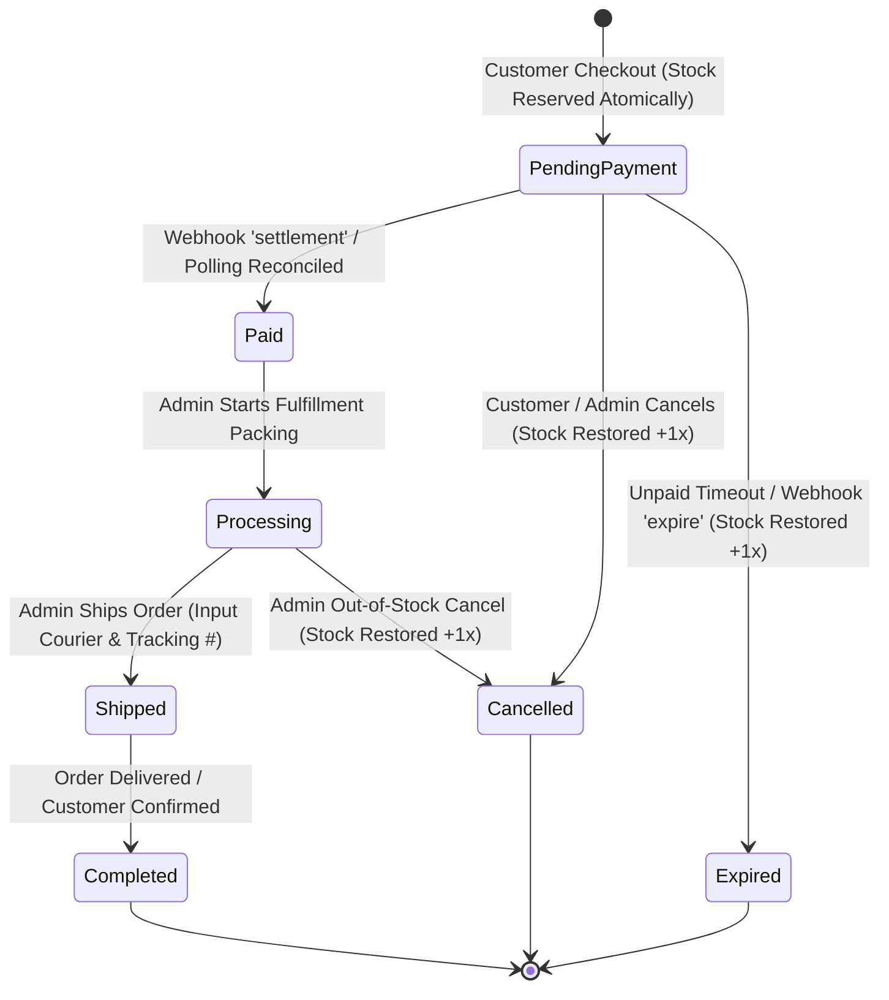
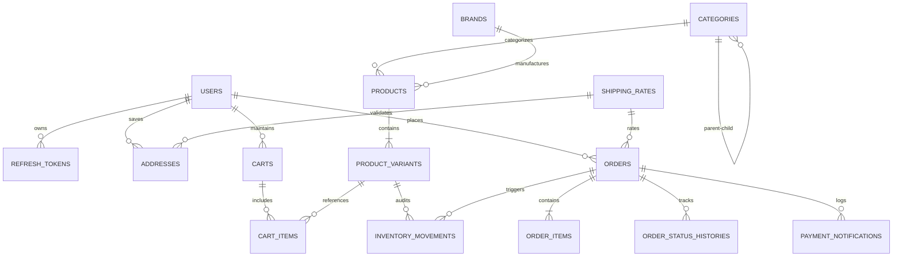

<div align="center">

# SportShop

### Enterprise-Grade High-Concurrency E-Commerce Platform

[](https://github.com/bintangnugrahaa/sportshop/actions/workflows/ci-backend.yml)
[](https://github.com/bintangnugrahaa/sportshop/actions/workflows/ci-frontend.yml)
[](https://github.com/bintangnugrahaa/sportshop/actions/workflows/docker.yml)
[](https://github.com/bintangnugrahaa/sportshop/actions/workflows/codeql.yml)
[](LICENSE)
[](https://dotnet.microsoft.com/)
[](https://react.dev/)
[](https://www.postgresql.org/)
[](https://redis.io/)
[](https://owasp.org/www-project-application-security-verification-standard/)

<p align="center">
  A production-ready, resilient, and horizontally scalable single-merchant e-commerce platform for sporting gear.<br />
  Engineered with <strong>Clean Architecture</strong>, strict <strong>Domain-Driven Design (DDD)</strong>, atomic conditional stock reservations (<strong>zero overselling</strong>), constant-time cryptographic payment reconciliation, and automated background workers.
</p>

[Key Features](#key-features) •
[Architecture](#system-architecture) •
[Domain & State Machine](#order-lifecycle--state-machine) •
[Database Design](#database-design--schema) •
[Quickstart](#quickstart--developer-experience) •
[Midtrans Sandbox](#midtrans-payment-gateway-integration) •
[Testing & QA](#testing--quality-assurance) •
[Observability](#observability--sre) •
[Security & Compliance](#security--hardening)

---

</div>

## Executive Overview

**SportShop** is built to model how mission-critical financial and retail microservices operate at top-tier technology companies. Unlike naive e-commerce boilerplate, SportShop strictly addresses core engineering complexities of distributed retail systems:

1. **Zero Overselling Under High Concurrency**: Eliminates race conditions with atomic conditional database mutations (`UPDATE ... WHERE stock_quantity >= @qty`) accompanied by immutable inventory movement audit ledgers.
2. **Defensive Financial Integrity**: Midtrans Snap integration backed by constant-time SHA-512 signature validation, anti-replay unique constraints, out-of-order webhook reconciliation, and automated polling jobs.
3. **Resilient Domain State Engine**: Strictly enforced order state transitions guaranteeing that cancelled or expired transactions automatically and atomically return stock to available inventory exactly once.
4. **Cloud-Native & Hardened Infrastructure**: Containerized with unprivileged non-root users, reverse-proxied with hardened Nginx headers, cached with Redis cache-aside, monitored with OpenTelemetry and Serilog Seq, and verified against OWASP ASVS Level 2 security controls.

---

## System Architecture

SportShop adheres strictly to **Clean Architecture** and **Inversion of Control (IoC)** principles. The dependency flow points strictly inwards: `Api → Infrastructure → Application → Domain`.

```
                  ┌──────────────────────────────────────────────┐
                  │           React SPA (Vite + TypeScript)      │
                  │   Tailwind CSS + shadcn/ui + TanStack Query  │
                  └───────────────────────┬──────────────────────┘
                                          │ HTTPS / REST / JWT
                                          ▼
                  ┌──────────────────────────────────────────────┐
                  │        Nginx Unprivileged Reverse Proxy      │
                  │      (TLS Termination, Rate Limiting, CSP)   │
                  └───────────────────────┬──────────────────────┘
                                          │
                                          ▼
                  ┌──────────────────────────────────────────────┐
                  │          SportShop ASP.NET Core Web API       │
                  │     (Clean Architecture / Minimal / CQRS)    │
                  └──────┬────────────┬─────────────┬────────────┘
                         │            │             │
        ┌────────────────┼────────────┼─────────────┼────────────────┐
        ▼                ▼            ▼             ▼                ▼
┌──────────────┐ ┌──────────────┐ ┌───────┐ ┌───────────────┐ ┌─────────────┐
│ PostgreSQL 17│ │Redis 7 Cache │ │Seq OTel││ Hangfire Jobs │ │Midtrans Snap│
│  (Data Store)│ │(Cache-Aside) │ │ (Logs) ││(Storage in DB)│ │(Gateway/Pay)│
└──────────────┘ └──────────────┘ └───────┘ └───────────────┘ └─────────────┘
```

### Architectural Layering

| Layer                          | Responsibilities                                                                                                                                                                | Constraints                                                                                       |
| ------------------------------ | ------------------------------------------------------------------------------------------------------------------------------------------------------------------------------- | ------------------------------------------------------------------------------------------------- |
| **`SportShop.Domain`**         | Enterprise business rules, Entities, Aggregates, Value Objects, Domain Exceptions, Domain Enums (`OrderStatus`, `StockReason`).                                                 | **Zero external dependencies.** No EF Core, no ASP.NET, no serialization annotations.             |
| **`SportShop.Application`**    | Use case handlers, Command/Query models, DTOs, Repository interfaces (`IOrderRepository`, `IPaymentGateway`), FluentValidation validators, Riok.Mapperly compile-time mappers.  | No direct database context, no raw HTTP client implementations, no direct framework dependencies. |
| **`SportShop.Infrastructure`** | EF Core `AppDbContext`, PostgreSQL entity configurations, Redis distributed caching, Hangfire recurrent jobs, Midtrans API client with Polly HTTP resilience, SMTP Mail client. | Implements interfaces defined in `Application`. Contains zero core business rules.                |
| **`SportShop.Api`**            | Thin REST controllers, JWT middleware, RFC 7807 ProblemDetails exception handling, Dependency Injection root, Swagger / OpenAPI documentation, HealthChecks.                    | Translates HTTP requests to Application commands, returns standardized responses.                 |

---

## Order Lifecycle & State Machine

Order state management follows a deterministic state machine. Illegal status progressions are rejected at the Domain level, ensuring complete transactional consistency.



### Stock Concurrency & Atomic Reservation

To prevent race conditions during high-concurrency flash sales, stock reservation bypasses naive read-then-write mechanisms and executes an atomic conditional PostgreSQL statement:

$$\text{Available Stock} = \text{Current Stock} - \text{Requested Quantity} \quad \text{where} \quad \text{Current Stock} \ge \text{Requested Quantity}$$

```csharp
// Atomically executed inside a database transaction:
UPDATE product_variants
SET stock_quantity = stock_quantity - @quantity
WHERE id = @variantId AND stock_quantity >= @quantity;
```

If the row count affected is zero, the transaction rolls back immediately and returns an `RFC 7807` `409 Conflict` payload with error code `inventory.insufficient_stock`.

---

## Database Design & Schema

PostgreSQL 17 serves as the system of record, configured with strict referential integrity, foreign key cascading guards, snake_case column mapping, and database-level unique indexes.



### Core Data Integrity Rules

- **Order Items Immutability**: Product title, SKU, variant size/color, and unit price are snapshotted into `order_items` at checkout time. Future price or catalog adjustments never alter historical records.
- **Financial Precision**: All monetary calculations utilize C# `decimal` and PostgreSQL `numeric(18,2)` before integer rounding for Midtrans IDR transactions.
- **Optimistic Concurrency**: Aggregates utilize PostgreSQL system column concurrency checks (`xmin`) to eliminate lost-update anomalies.

---

## Midtrans Payment Gateway Integration

SportShop implements production-grade defensive integration with **Midtrans Snap**:

```
[Customer Browser] ──(1) Checkout /api/v1/orders/checkout──► [SportShop API]
       ▲                                                          │
       │ (2) Snap Token & Redirect URL                            ▼
       │                                                 [Midtrans Snap Engine]
       ▼                                                          │
[Midtrans Snap Popup] ───(3) Customer Pays via Simulator          │
                                                                  ▼
[Midtrans Webhook Server] ──(4) HTTP POST Notification──► [SportShop Webhook API]
                                                                  │
                                                          (Constant-Time SHA512)
                                                          (Anti-Replay Verification)
                                                                  ▼
                                                      [Atomic Status Update: Paid]
```

### Webhook Security Architecture

1. **Constant-Time Cryptographic Verification**:
   The webhook payload signature is calculated and verified in constant time to prevent side-channel timing attacks:
   $$\text{Signature} = \text{SHA512}(\text{OrderId} + \text{StatusCode} + \text{GrossAmount} + \text{ServerKey})$$
2. **Replay Attack & Duplicate Protection**:
   Incoming notifications are persisted into `payment_notifications`. Unique composite constraints on `(order_id, transaction_id, status_code)` guarantee idempotent execution even under aggressive network retry policies.
3. **Out-of-Order Safety**:
   If an out-of-order notification arrives (e.g., `pending` arriving after `settlement`), the domain state machine ignores regressions and maintains the terminal `Paid` status.
4. **Automated Status Reconciliation**:
   `ReconcilePaymentsJob` runs periodically via Hangfire to poll Midtrans Core API for transactions left pending due to dropped network callbacks.

---

## Key Features

### Customer Experience (Storefront)

- 🛍️ **Catalog Browsing & Search**: Real-time faceted search by category hierarchy, brand, price range, and in-stock availability.
- ⚡ **Optimistic Cart & Live Stock Warnings**: Persistent cart with automatic visual alerts when item prices change or stock becomes insufficient.
- 📍 **Weight-Based Flat Shipping**: Regional rate engine calculating exact shipping tariffs based on destination province and aggregated cart weight (1 kg threshold with ceiling rounding).
- 💳 **Seamless Midtrans Snap Checkout**: Integrated modal supporting Virtual Accounts (BCA, BNI, BRI, Mandiri, Permata), QRIS / GoPay, and 3D-Secure Credit Cards.
- 📦 **Order Tracking & Cancellation**: Self-service tracking with real-time status timelines and 1-click order cancellation before payment.

### Merchant & Operations (Admin Panel)

- 📊 **Executive KPI Dashboard**: Real-time analytics on gross revenue, active orders, conversion rates, and stock deficit alerts.
- 📦 **Catalog & Inventory Control**: Comprehensive management of categories, brands, variants (size, color, SKU), image uploads (MIME & size validated), and atomic stock adjustments.
- 🚚 **Fulfillment Operations**: Order processing lifecycle, courier assignment, tracking number injection, and dispatch management.
- ⚙️ **Tariff Administration**: Province-based flat shipping rate configuration with automatic cache invalidation.

---

## Tech Stack & Decision Matrix

| Domain                       | Technology                     | Justification                                                                                           |
| ---------------------------- | ------------------------------ | ------------------------------------------------------------------------------------------------------- |
| **Runtime & Language**       | C# 12 / .NET 8 (LTS)           | High-throughput asynchronous runtime, memory efficiency, and native AoT / container optimizations.      |
| **Web API Framework**        | ASP.NET Core Web API           | Production-proven HTTP pipeline, built-in rate limiting, and dependency injection.                      |
| **Object-Relational Mapper** | Entity Framework Core 8        | Native PostgreSQL LINQ translations, robust migration management, and compile-time query verification.  |
| **Database**                 | PostgreSQL 17                  | Enterprise ACID compliance, robust indexing (`GIN`, `BTREE`), and row-level concurrency locking.        |
| **Caching Layer**            | Redis 7                        | Sub-millisecond read latency for catalog caching, distributed locking, and cache-aside patterns.        |
| **Background Processing**    | Hangfire                       | Reliable persistent background jobs stored in PostgreSQL with built-in dashboard and automated retries. |
| **Observability**            | Serilog + OpenTelemetry + Seq  | Structured JSON logs enriched with correlation IDs, tracing EF Core and outbound HTTP calls.            |
| **Frontend Framework**       | React 18 + TypeScript (Strict) | Type-safe UI components, predictable state flow, and zero runtime type errors.                          |
| **State & Data Fetching**    | TanStack Query v5 + Zustand    | Separation of server state (caching, revalidation) and client UI state (drawer, auth tokens).           |
| **Styling & UI Kit**         | Tailwind CSS + shadcn/ui       | Atomic CSS with high-performance CSS bundle sizes and accessible headless UI primitives.                |

---

## Quickstart & Developer Experience

### System Prerequisites

- [Docker Desktop](https://www.docker.com/products/docker-desktop/) (or Docker Engine 24+ and Docker Compose v2)
- [.NET 8.0 SDK](https://dotnet.microsoft.com/download/dotnet/8.0) _(only required for bare-metal local development)_
- [Node.js 20+ & npm](https://nodejs.org/) _(only required for bare-metal frontend development)_

---

### Option 1: One-Click Docker Compose (Recommended)

Get the entire production-grade ecosystem (API, Web, DB, Redis, Seq, Hangfire, Mailpit) running in under 5 minutes:

```bash
# 1. Clone the repository
git clone https://github.com/bintangnugrahaa/sportshop.git
cd sportshop

# 2. Copy the preconfigured development environment
cp .env.example .env

# 3. Spin up all containerized services
docker compose up -d --build
```

#### Service Port Reference

| Service                  | Local Address                                                    | Credentials             | Purpose                                |
| ------------------------ | ---------------------------------------------------------------- | ----------------------- | -------------------------------------- |
| **Frontend Web App**     | [http://localhost:5173](http://localhost:5173)                   | —                       | Customer Storefront & Admin Portal     |
| **ASP.NET Core Web API** | [http://localhost:5080](http://localhost:5080)                   | —                       | RESTful API Endpoints                  |
| **Swagger / OpenAPI**    | [http://localhost:5080/swagger](http://localhost:5080/swagger)   | —                       | Interactive API Documentation          |
| **Hangfire Dashboard**   | [http://localhost:5080/hangfire](http://localhost:5080/hangfire) | _Admin Only_            | Background Job Orchestration           |
| **Seq Observability**    | [http://localhost:5341](http://localhost:5341)                   | —                       | Structured Logs & OpenTelemetry Traces |
| **Mailpit Inbox**        | [http://localhost:8025](http://localhost:8025)                   | —                       | Transactional Email Interceptor        |
| **PostgreSQL Database**  | `localhost:5432`                                                 | `postgres` / `postgres` | Primary Database (`sportshop`)         |
| **Redis Cache**          | `localhost:6379`                                                 | —                       | In-Memory Distributed Cache            |

#### Default Seed Data

- **Administrator**: `admin@sportshop.com` / `J3&fP6z@`
- **Demo Catalog**: Automatically seeds ~30 sports products across categories (Shoes, Jerseys, Rackets, Balls, Accessories) with multiple variants, SKUs, and stock quantities.

---

### Option 2: Bare-Metal Development

Run backend and frontend directly on the host with hot-reloading while keeping backing services in Docker:

```bash
# 1. Start backing services only
docker compose up -d db redis seq mailpit

# 2. Launch Backend API
cd backend
dotnet restore
dotnet run --project src/SportShop.Api

# 3. Launch Frontend App (in a separate terminal)
cd frontend
npm ci
npm run dev
```

---

## Environment Variables Reference

| Variable                     | Description                                             | Default Dev Value                                                           |
| ---------------------------- | ------------------------------------------------------- | --------------------------------------------------------------------------- |
| `POSTGRES_USER`              | PostgreSQL superuser username                           | `postgres`                                                                  |
| `POSTGRES_PASSWORD`          | PostgreSQL superuser password                           | `postgres`                                                                  |
| `POSTGRES_DB`                | Application database name                               | `sportshop`                                                                 |
| `ConnectionStrings__Default` | ADO.NET connection string                               | `Host=db;Port=5432;Database=sportshop;Username=postgres;Password=postgres;` |
| `Redis__ConnectionString`    | Redis host and port                                     | `redis:6379`                                                                |
| `Jwt__Key`                   | Secret key for signing HMAC-SHA256 JWTs (&ge; 32 chars) | _(Secure dev string)_                                                       |
| `Jwt__Issuer`                | Valid JWT issuer                                        | `SportShopApi`                                                              |
| `Jwt__Audience`              | Valid JWT audience                                      | `SportShopClient`                                                           |
| `Midtrans__ServerKey`        | Midtrans Sandbox Server Key                             | `SB-Mid-server-xxxx`                                                        |
| `Midtrans__ClientKey`        | Midtrans Sandbox Client Key                             | `SB-Mid-client-xxxx`                                                        |
| `Midtrans__IsProduction`     | Toggle between Sandbox and Production gateway           | `false`                                                                     |
| `Cors__Origins`              | Allowed origins for CORS policy (comma-separated)       | `http://localhost:5173,http://localhost:80`                                 |
| `Seq__ServerUrl`             | Seq ingestion endpoint for Serilog                      | `http://seq:5341`                                                           |
| `Otel__OtlpEndpoint`         | OpenTelemetry OTLP collector endpoint                   | `http://seq:5341/ingest/otlp`                                               |
| `Smtp__Host`                 | SMTP server host                                        | `mailpit`                                                                   |
| `Smtp__Port`                 | SMTP port                                               | `1025`                                                                      |
| `SEED_ADMIN_EMAIL`           | Bootstrap admin account email                           | `admin@sportshop.com`                                                       |
| `SEED_ADMIN_PASSWORD`        | Bootstrap admin account password                        | `J3&fP6z@`                                                                  |
| `SEED_DEMO_DATA`             | Automatically populate demo products on startup         | `true`                                                                      |

---

## Midtrans Payment Gateway Integration

### 1. Setup Sandbox Keys & Webhook Tunneling

1. Retrieve your API keys from the [Midtrans Sandbox Dashboard](https://dashboard.sandbox.midtrans.com/) (**Settings** &rarr; **Access Keys**).
2. Expose your local backend webhook endpoint via Cloudflare Tunnel or ngrok:
    ```bash
    # Expose port 5080
    cloudflared tunnel --url http://localhost:5080
    # or: ngrok http 5080
    ```
3. Set the **Payment Notification URL** in Midtrans Settings &rarr; Configuration to:
   `https://<your-tunnel-subdomain>/api/v1/payments/midtrans/notification`

### 2. Sandbox Payment Simulator

Use the official [Midtrans Simulator](https://simulator.sandbox.midtrans.com/) to complete payments:

- **Virtual Account**: Copy the VA number from the Snap popup into the simulator and submit payment.
- **QRIS / GoPay**: Scan the generated QR code using the simulator's QR scanner.
- **Credit Card Test Credentials**:
    - Card Number: `4811 1111 1111 1114`
    - Expiry: Any future date (e.g., `12/28`)
    - CVV: `123`
    - 3D Secure OTP: `112233`

---

## Testing & Quality Assurance

SportShop is backed by rigorous test automation across all layers:

```
Testing Suite Hierarchy:
┌────────────────────────────────────────────────────────┐
│  Integration Tests: WebApplicationFactory +            │
│  Testcontainers (Real PostgreSQL 17 + Redis 7 instances)│
├────────────────────────────────────────────────────────┤
│  Application Tests: Use case handlers, FluentValidation│
│  business rules, Riok.Mapperly DTO mapping             │
├────────────────────────────────────────────────────────┤
│  Domain Tests: Pure unit tests on Entities, Value      │
│  Objects, Stock invariants, and State Transitions      │
├────────────────────────────────────────────────────────┤
│  Frontend Tests: Vitest, React Testing Library,        │
│  Zod schemas, and Axios interceptor suites             │
└────────────────────────────────────────────────────────┘
```

### Running Backend Tests (.NET)

Integration tests dynamically spin up isolated PostgreSQL and Redis Docker containers via **Testcontainers**—guaranteeing 100% parity with production behavior:

```bash
cd backend

# Execute all Unit and Integration tests
dotnet test --verbosity normal

# Run tests with code coverage analysis
dotnet test --collect:"XPlat Code Coverage" --results-directory ./TestResults
```

_Quality Standards Enforced:_

- `SportShop.Domain.Tests`: **100% pass rate** (&ge; 90% code coverage target)
- `SportShop.Application.Tests`: **100% pass rate** (&ge; 80% code coverage target)
- `SportShop.Api.IntegrationTests`: **100% pass rate** across all API flows

### Running Frontend Tests (Vitest)

```bash
cd frontend

# Run test suite
npm run test

# Type checking & ESLint
npm run typecheck
npm run lint

# Production build verification
npm run build
```

---

## Observability & SRE

SportShop incorporates comprehensive Site Reliability Engineering (SRE) primitives:

- **Structured Log Enrichment**: Logs emitted via Serilog include `TraceId`, `SpanId`, `CorrelationId`, `UserId`, `ClientIp`, and `OrderNumber`.
- **Distributed Tracing**: OpenTelemetry traces database queries (EF Core), Redis commands, and outbound HTTP transactions to Midtrans.
- **Health Probes**:
    - `GET /health/live`: Liveness probe for orchestrators (Kubernetes/Docker).
    - `GET /health/ready`: Readiness probe validating PostgreSQL connection pool, Redis ping, and Hangfire worker status.
- **Background Worker Monitoring**: Hangfire dashboard provides real-time visibility into queue depth, failed jobs, and execution retries.

---

## Security & Hardening

The codebase complies with **OWASP Application Security Verification Standard (ASVS) Level 2**:

- **Authentication & Token Lifecycle**: Access tokens (15-min TTL) coupled with DB-persisted, cryptographically hashed refresh tokens (7-day TTL). Automated token rotation with reuse detection terminates active sessions upon detected anomalies.
- **Resource Ownership Authorization**: Strict ownership validation ensures customers cannot query, mutate, or inspect other users' carts, orders, or addresses.
- **RFC 7807 ProblemDetails**: Machine-readable error payloads preventing stack trace leakage while providing clear error codes.
- **Container Hardening**: Docker images run as unprivileged users (`USER $APP_UID` in .NET runtime, `nginxinc/nginx-unprivileged` in frontend) preventing container-breakout escalation.
- **Network Defenses**: Rate limiting on sensitive endpoints (Auth, Checkout), strict CORS policies, and HTTP security headers (`X-Frame-Options: DENY`, `X-Content-Type-Options: nosniff`, `Strict-Transport-Security`).

---

## Continuous Integration & Deployment (CI/CD)

GitHub Actions workflows continuously validate and package the repository:

- **CI Backend (`ci-backend.yml`)**: Automates restore, compilation with `--warnaserror`, formatting verification with `dotnet format`, unit and integration testing with code coverage reporting.
- **CI Frontend (`ci-frontend.yml`)**: Enforces ESLint rules, TypeScript strict compilation, Vitest test execution, and production bundling.
- **Docker Images (`docker.yml`)**: Builds multi-stage production images and publishes them to GitHub Container Registry (GHCR) upon release tags and pushes to `main`.
- **CodeQL Security (`codeql.yml`)**: Advanced static security analysis scanning for SQL injection, CSRF, insecure deserialization, and memory safety flaws.

---

## Engineering Guidelines & Contributions

1. **Commit Conventions**: All commits adhere to [Conventional Commits](https://www.conventionalcommits.org/):
    - `feat(orders): implement stock reservation on checkout`
    - `fix(auth): prevent refresh token reuse anomaly`
    - `docs(api): update swagger schemas for shipping quotes`
2. **Pull Request Protocol**:
    - Ensure all CI checks (Backend, Frontend, Docker, CodeQL) are green.
    - Accompany bug fixes with a regression test.
    - Maintain zero compiler warnings (`TreatWarningsAsErrors=true`).

---

## License

This project is licensed under the terms of the [MIT License](LICENSE).
